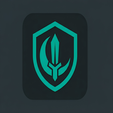

#  HaramVeil

[](https://github.com/darkmaster0345/HaramVeil/actions/workflows/build.yml)
[](https://www.gnu.org/licenses/gpl-3.0)
[](https://developer.android.com/about/versions/10)
[](https://kotlinlang.org/)
[](https://f-droid.org/)

> "Tell the believing men to lower their gaze and guard their private parts. That is purer for them." - **Quran 24:30**

**HaramVeil** is a sophisticated, privacy-centric Android application engineered to help users maintain spiritual purity. It serves as an automated "digital guardian" that identifies and veils adult content in real-time across the entire device using advanced local AI and layered detection heuristics.

---

> 📚 **Full documentation** lives in the [`docs/`](docs/) folder: [Architecture](docs/ARCHITECTURE.md), [Detection Pipeline](docs/DETECTION.md), [Security & Privacy](docs/SECURITY.md), [Development](docs/DEVELOPMENT.md), [Features](docs/FEATURES.md), and [FAQ](docs/FAQ.md). A companion site is published to GitHub Pages.

## 🌟 Vision & Purpose

In an age where explicit content is often just a click away, **HaramVeil** aims to provide a proactive safety net. Unlike standard DNS blockers that can be easily bypassed or miss embedded content, HaramVeil analyzes what is actually being displayed on your screen, providing a last line of defense that is both intelligent and difficult to circumvent.

---

## ✨ Comprehensive Features

### 🛡️ Layered Detection Architecture
HaramVeil employs a triple-threat detection pipeline to ensure maximum coverage:

#### 1. Mode 1: UI Tree Analysis (Keyword & Domain)
*   **How it works**: Directly inspects the accessibility node tree of active applications.
*   **Keyword Matching**: Matches against an encrypted local blocklist of keywords (e.g., adult terms, suggestive phrases).
*   **Domain Matching**: Specialized handling for web browsers. It extracts the URL/Domain from the address bar and matches it against a blocked domain list.
*   **Risk Levels**: Differentiates between LOW, MEDIUM, and HIGH risk scenarios to determine the appropriate veil intensity.

#### 2. Mode 2: Intelligent OCR (Optical Character Recognition)
*   **Visual Text Extraction**: Periodically captures internal screenshots (processed entirely in memory) to find text that might be hidden from the UI tree (e.g., text inside images or videos).
*   **Engines**:
    *   **Google ML Kit**: High performance and precision.
    *   **RapidOCR ONNX**: A fully open-source alternative for those who prefer no Google dependencies.
*   **Dynamic Scanning**: Only triggers when "High Risk" apps are in the foreground, saving battery.

#### 3. Mode 3: Visual AI Inference (NudeNet)
*   **Deep Learning**: Runs state-of-the-art **NudeNet v3.4** deep learning models.
*   **Imagery Detection**: Detects explicit imagery, suggestive poses, and specific body parts.
*   **Local Inference**: Operates locally using ONNX Runtime. Your screen data never leaves the device.
*   **Multiple Models**: Choose between a 6MB "Mobile" model for speed and a 15MB "Enhanced" model for better accuracy.

---

### 🔒 Hardened Security & Anti-Bypass
*   **Lockdown Mode**: When adult content is detected, the app can trigger a persistent "Lockdown" that sends the user home and prevents them from returning to the offending app for a set period.
*   **PIN Protection**: All sensitive settings, including the ability to disable protection or uninstall the app, are gated behind a secure, hashed PIN.
*   **Security Questions**: Recovery mechanism for the PIN using customizable security questions.
*   **Device Admin Integration**: Prevents accidental or impulsive uninstallation by requiring the PIN to deactivate the Device Admin receiver.
*   **Safe Window**: Need to change sensitive settings or add a site to the allowlist? Open a "Safe Window" with your PIN. It auto-resumes protection after a timeout (default 5 mins) to ensure you don't forget to turn it back on.

---

### 📊 Insights & Stats
*   **Encrypted History**: View your protection stats (number of blocks, time saved) in an encrypted local database.
*   **Historical Trends**: Track your progress over time with local-only charts.
*   **SQLCipher Encryption**: All stats are keyed to your PIN hash, ensuring privacy even if your device is compromised.

---

## 🛠️ Technical Deep Dive

### Tech Stack
| Layer | Technology |
|:--- |:--- |
| **Language** | Kotlin (100%) |
| **UI** | Jetpack Compose + Material 3 |
| **Async/State** | Coroutines & StateFlow |
| **Storage** | DataStore (Preferences) + SQLCipher (SQLite) |
| **AI Engine** | ONNX Runtime (NudeNet v3.4) |
| **OCR** | ML Kit / RapidOCR (ONNX) |
| **Architecture** | Clean Architecture / MVI-ish |

### Internal Components
- `accessibility/`: The `HaramVeilAccessibilityService` - the entry point for all monitoring.
- `detection/`: The core logic for UI scanning (Mode 1), OCR (Mode 2), and AI Inference (Mode 3).
- `overlay/`: A native window overlay service (`VeilOverlayService`) that draws the "Veil" over the screen with hardware acceleration.
- `security/`: Advanced PIN management, Bcrypt hashing, and Device Admin controllers.
- `service/`: Sticky background service lifecycle, boot recovery, and health monitoring workers.
- `ui/`: Modern Compose-based interface featuring a clean Dashboard, deep Settings, and Stats.

---

## 📦 Build Flavors

HaramVeil is available in two flavors to suit different user needs:

| Flavor | OCR Engine | External Deps | Target Audience |
|:--- |:--- |:--- |:--- |
| **fossOnnx** | RapidOCR | 100% Open Source | F-Droid users, Privacy advocates |
| **mlkit** | Google ML Kit | Proprietary Binaries | Performance-focused users |

---

## 🚀 Installation & Setup

### For Users

#### Option A: F-Droid (Recommended)
Once the app is accepted into the main F-Droid repository:
1. Open [F-Droid](https://f-droid.org/) on your device.
2. Search for "HaramVeil".
3. Tap Install.

The F-Droid build uses the `fossOnnx` flavor — 100% open-source, no Google dependencies, no INTERNET permission.

#### Option B: Direct APK Download
1. Download the latest APK from the [Releases](https://github.com/darkmaster0345/HaramVeil/releases) page.
    - Choose `HaramVeil-fossOnnx-release.apk` for the fully open-source version.
    - Choose `HaramVeil-mlkit-release.apk` for the Google ML Kit version (slightly faster OCR).
2. Install the APK (allow "Unknown Sources" if prompted).
3. **Important**: Grant **Accessibility** and **Display over other apps** (Overlay) permissions during onboarding.
4. Set a strong PIN and choose recovery questions you will remember.

#### Option C: Build from Source
```bash
git clone https://github.com/darkmaster0345/HaramVeil.git
cd HaramVeil
./gradlew :app:assembleFossOnnxRelease
# APK: app/build/outputs/apk/fossOnnx/release/app-fossOnnx-release-unsigned.apk
```

### For Developers
1. **Prerequisites**: Android Studio Ladybug+, JDK 17, Android SDK 36.
2. **Clone**: `git clone https://github.com/darkmaster0345/HaramVeil.git`
3. **Build**:
   ```bash
   # For FOSS version
   ./gradlew :app:assembleFossOnnxRelease
   # For ML Kit version
   ./gradlew :app:assembleMlkitRelease
   ```

---

## 📜 Permissions Explained

| Permission | Necessity |
|:--- |:--- |
| `BIND_ACCESSIBILITY_SERVICE` | Required to "read" the UI tree for detection. The app cannot function without this. |
| `SYSTEM_ALERT_WINDOW` | Required to draw the protective veil on top of other apps. |
| `BIND_DEVICE_ADMIN` | Used to prevent uninstallation without the app PIN. |
| `RECEIVE_BOOT_COMPLETED` | Ensures protection starts automatically when the phone turns on. |
| `POST_NOTIFICATIONS` | Displays a persistent notification showing the protection status. |
| `KILL_BACKGROUND_PROCESSES` | Used in lockdown mode to help close offending applications. |

---

## ❓ Frequently Asked Questions

**Q: Will this slow down my phone?**
A: HaramVeil is highly optimized. Mode 3 (Visual AI) uses hardware acceleration where available. The app also features a "Battery vs. Protection" slider to adjust scanning frequency.

**Q: Is my screen data being uploaded?**
A: **Never.** All processing (OCR, AI Inference, Keyword Matching) happens strictly on your device. HaramVeil does not even have the `INTERNET` permission in production builds.

**Q: Can I use this with a VPN or DNS blocker?**
A: Yes! It is highly recommended to use HaramVeil as a "last line of defense" alongside network-level blockers like NextDNS or AdGuard.

---

## 🤝 Contributing

We welcome contributions! Whether it's fixing a bug, adding a feature, or improving the blocklist.
- **Bug Reports**: Open an issue with clear steps to reproduce.
- **Pull Requests**: Ensure your code follows the existing style and passes all tests.
- **Translations**: Help us reach the global Ummah by contributing translations.

---

## ⚖️ License

Copyright (C) 2026 Ubaid ur Rehman

This program is free software: you can redistribute it and/or modify it under the terms of the **GNU General Public License v3.0**. See the [LICENSE](LICENSE) file for details.

---

<p align="center">
  <b>Built for the community, by the community.</b><br>
  May Allah reward all those who strive for purity.
</p>
